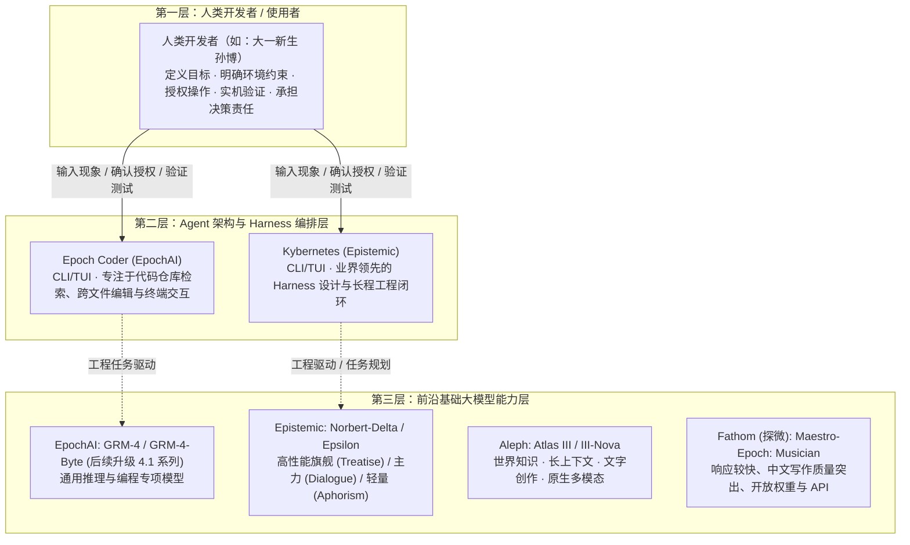

# 《总谱》架空设定

> **定位**：本文档为《总谱》（Maestro）架空世界的技术基准与演进事实源，用于保障技术背景与故事时间线的一致性。
>
> **维护规则**：遵循 [`lore-maintenance.md`](lore-maintenance.md)，优先增量维护；事实确定需经讨论锁定，不预先虚构 Canon；严禁在正文中让角色提前使用未解锁的技术。

---

## 一、世界时间线与双轴原则

《总谱》采用**架空时间与现实技术映射的双轴基准**：

| 时间维度 | 设定基准 | 核心说明 |
| :--- | :--- | :--- |
| **故事时间起点** | **2021 年 9 月** | 以 2021 年秋季的现实日历为基准展开社会生活与大学校园背景。 |
| **技术参照窗口** | **现实 2025 年 9—11 月** | 开篇时架空世界的 AI 基础模型、Agent 产品生态与工程 Harness 成熟度，总体对标这一现实时期的技术水准。此为能力参照基准，不代表现实该阶段的所有具体特性都在开篇第一天全面就位。 |
| **技术演进法则** | **独立演进原则** | 2021 年 9 月之后，架空世界的 AI 技术发展遵循小说内部的产业竞争与技术突破节奏，拥有独立的时间线与产品代际，不机械绑定现实历史的发布顺序与演进细节。 |

### ▌ 开篇人机协同与技术三层架构

---

## 二、开篇技术基准（对标现实 2025 年秋季）

### 1. 基础模型能力与推理机制

- **复杂推理与规划**：前沿模型具备强大的复杂逻辑推导、跨文件工程理解与多步骤任务规划能力；推理时计算与扩展思考已成为前沿竞争的核心技术路线。
- **长上下文与多模态**：原生多模态输入与长上下文窗口已进入实用阶段。不同模型在上下文容量、有效召回理解深度及跨任务连续记忆上存在客观差异，并非所有模型都能在极端长度下保持同等可靠性。

### 2. Agent 架构与 Harness 成熟度

- **多样化生态与实用产品**：AI IDE、命令行（CLI）Agent、云端编程平台与开源 Harness 框架已形成多样化生态，部分产品进入成熟实用阶段，支持较长时间的自主工程任务，不同工具之间的可靠性与适用范围存在客观差异。
- **工程级执行闭环**：具备工程级 Agent 能力的工具能够自主检索并理解代码库、规划并执行跨文件修改、调用系统终端运行构建与测试、解析运行反馈并持续迭代修复。
- **工程保障机制落地**：权限分级控制、沙箱隔离、检查点与撤销恢复、上下文智能管理与任务续接等机制已在各类工具中得到实际应用。

### 3. 客观瓶颈与人机协同边界

> [!WARNING] 真实工程的技术瓶颈
> 前沿 Agent 已能参与系统架构设计与大规模重构，但仍面临：
> 1. **长程自主执行的可靠性衰减**；
> 2. **超长上下文中的细微信息损失**；
> 3. **复杂的宿主环境依赖排错**；
> 4. **未知边缘场景下的逻辑盲区**；
> 5. **高强度推理与高频工具调用的延迟与计算成本**。

> [!IMPORTANT] 动态人机协同法则
> - **人类职责**：主要负责清晰定义任务目标、明确关键业务与环境约束、提供权限授权、验证验收，并对最终交付结果承担决策责任。
> - **系统职责**：模型与 Harness 协同推进具体的探索、架构规划、编码与自测。
> - **动态演进**：人机分工**不是**固定的人类设计架构、AI 负责实现，而是随着技术发展和任务情境动态演进。

---

## 三、已确定的架空 AI 厂商与产品

### 1. EpochAI（对标现实：OpenAI）

| 属性 | 设定事实 | 属性 | 设定事实 |
| :--- | :--- | :--- | :--- |
| **企业全称** | EpochAI | **现实对标** | OpenAI |
| **基础模型家族** | **GRM** | **面向大众产品** | **EpochChat**（网页聊天应用） |
| **专业编程产品** | **Epoch Coder** | **首发形态** | **CLI / TUI**（无独立桌面端） |

EpochAI 是架空世界中的前沿 AI 厂商。2021 年秋季，其通用旗舰与 Agent 编程专项模型形成明确分工。2022 年初迎来第四世代的重要演进。

#### ▌ 发布历史与产品矩阵

| 故事时间 | 正式名称 | 技术层级 | 现实参照 | 核心能力与关键定位 | 确定状态 |
| :---: | :--- | :---: | :--- | :--- | :---: |
| **2021.08 下旬** | **GRM-4** | 通用基础模型 | GPT-5 初代 | 新一代通用旗舰模型；覆盖通用推理、复杂任务与编程。 | 已确定 |
| **2021.09 上旬** | **GRM-4-Byte** | 专项基础模型 | GPT-5-Codex | 面向 Harness/Agent 编程任务优化的专项模型；重点是代码仓库理解、跨文件修改及工具反馈驱动的工程任务。 | 已确定 |
| **2021.09 上旬** | **Epoch Coder** | 编程 Agent / Harness | CLI/TUI Agent | EpochAI 推出的 Agent 编程工具，首发只有终端形态，**没有独立桌面客户端**。默认使用 GRM-4-Byte，允许手动切换 GRM-4。 | 已确定 |
| **2022.02（待定）** | **GRM-4.1** | 通用基础模型（升级） | GPT-5.1 通用版 | GRM-4 世代重大升级；综合能力跃居同期前沿模型首位，尤其在复杂推理、数学及高难度编程方面建立**明显领先优势**。语言风格、多模态和长上下文等维度不预设全面领先。 | 已确定（日期待定） |
| **2022.03（待定）** | **GRM-4.1-Byte** | 专项基础模型（升级） | GPT-5.1-Codex | GRM-4.1 世代的 Agent 编程专项升级；进一步提升大型代码库修改、工具反馈利用及连续工程任务能力，在可比较的模型层面专业编程评测中建立**明显领先优势**，并接入 Epoch Coder。 | 已确定（日期待定） |

> [!NOTE] 架构认知：模型与 Harness 解耦
> - **GRM 是模型**，负责语言与代码理解推导；
> - **Epoch Coder 是承载模型并组织工具调用和工程执行的产品/Harness**，具备实用的代码检索、多文件编辑、终端命令执行、构建与测试反馈、上下文管理及基本权限控制；
> - 二者各自独立演进。

> [!TIP] 2022 年初竞争定位与技术客观性
> - GRM-4.1 和 GRM-4.1-Byte 属于同一第四世代的两次重要能力升级，**不等于 GRM-5 发布**。
> - GRM-4.1 经过数月研发后在 2022 年 2 月显著改写综合 SOTA 格局；此前 2022 年 1 月发布的 Norbert-Epsilon 仍在长上下文复杂分析等任务中具有竞争力，2021 年 12 月发布的 Atlas III-Nova 在世界知识、有效长上下文、文字创作与多模态理解等任务上仍有明显优势。不同任务的优势并非全部由一家公司包揽。
> - **模型层面的显著领先，不推导出 Epoch Coder 在上下文管理、权限、工具执行与工程稳定性等 Harness 维度的全面反超**；完整开发工作流仍需单独评估。
> - 当前不锁定具体评测分数、训练算法、架构或细分排名，后续需要时再设计。

> [!WARNING] 待定与未锁定事项
> - [ ] 本阶段不预设 Epoch Coder 的详细权限档位、沙箱实施细则、界面菜单、计费数值或未来桌面端计划；只有实际剧情需要时再进一步确认。

---

### 2. Epistemic（对标现实：Anthropic）

| 属性 | 设定事实 | 属性 | 设定事实 |
| :--- | :--- | :--- | :--- |
| **企业全称** | Epistemic | **现实对标** | Anthropic |
| **基础模型家族** | **Norbert** | **命名规则** | `Norbert-希腊字母代际: 档位代号` |
| **专业编程产品** | **Kybernetes** | **主力世代** | 2021秋 **Delta（第四代）** / 2022.01 **Epsilon（第五代）** |
| **会员订阅体系** | **Epistemic 会员梯队**（古典学园与研习共同体） | **公开订阅** | 个人双档位（**Fellow** / **Senior Fellow**）及团队（**Collegium**） |

Epistemic 是架空世界中带有浓厚学术与理性主义色彩的前沿 AI 厂商。其模型正式命名中，希腊字母表示世代，档位代号表示能力与成本定位。

#### ▌ 会员订阅名称与当前权益（名称已确认，细则部分待定）

Epistemic 采用古典学园与学术共同体风格的会员名称。已确认孙博购买的 Fellow 约 20 美元/月，涵盖 Norbert 网页端与 Kybernetes 各自受限的用量权益。其余档位的精确价格、容量及机构服务方式尚未正式确定：

| 会员档位 | 官方全称 | 定位与适用群体 | 权益范围与核心配额 | 现实参照 |
| :--- | :--- | :--- | :--- | :---: |
| **免费档** | **Epistemic Inquirer**（探询者） | 体验者、大众尝鲜用户 | 基础网页对话体验，轻量模型配额，用量严格受限 | Free |
| **个人基础会员** | **Epistemic Fellow** ⭐ | 个人研究者、进阶开发者、重度用户（**孙博购买档位**） | **约 20 美元/月**。同时包含 Norbert 网页端高级权益与 Kybernetes CLI Agent 基础额度；**两者各有独立用量额度，非无限调用** | Pro ($20) |
| **个人高阶会员** | **Epistemic Senior Fellow** | 面向更高强度使用需求的候选定位 | 具体价格、用量倍率、并发及权益组合待确认 | 高阶个人订阅（参考方向） |
| **团队/实验室** | **Epistemic Collegium**（学院 / 同僚社） | 团队订阅的候选定位 | 是否提供共享额度、集中账单、席位协作和优先队列等，均待确认 | 团队订阅（参考方向） |

> [!NOTE] 机构与大型企业定制说明
> 机构及大型企业的销售渠道和产品形态**尚未锁定**。企业直销、合规审查、专用算力或 SLA 可作为未来讨论的候选方案，不能作为已发生的产品事实。

#### ▌ 发布历史与产品矩阵

| 故事时间 | 正式名称 | 技术层级 | 现实参照 | 核心能力与关键定位 | 确定状态 |
| :---: | :--- | :---: | :--- | :--- | :---: |
| **2021.08** | **Kybernetes** | 编程 Agent / Harness | CLI/TUI Agent | Epistemic 推出的编程 Agent/Harness；首发为 **CLI/TUI** 形态，**没有独立桌面客户端**。以复杂工程任务中的 Harness 设计、上下文组织、任务推进与执行可靠性见长，开篇阶段处于业界领先水平。 | 已确定 |
| **2021.09** | **Norbert-Delta: Treatise** | 基础模型（旗舰） | Claude Opus 4.5 | 高性能旗舰，主攻复杂逻辑推理、高难度编程与工程任务。 | 已确定 |
| **2021.10** | **Norbert-Delta: Dialogue** | 基础模型（主力） | Claude Sonnet 4.5 | 综合主力，兼顾编程实力、响应效率与使用成本。 | 已确定 |
| **2021.10** | **Norbert-Delta: Aphorism** | 基础模型（轻量） | Claude Haiku 4.5 | 轻量型号，强调响应速度和成本效率。 | 已确定 |
| **2022.01** | **Norbert-Epsilon: Treatise** | 基础模型（新旗舰） | Claude Opus 4.6 | 第五代高性能旗舰；强化复杂推理、代码仓库理解、跨文件修改、长任务规划与 Agent 工程任务表现。相比 Delta 更可靠，但并非从不能编程到能编程的质变。付费优先开放，**Epistemic Fellow** 权益（Norbert 网页端与 Kybernetes 渠道）可使用；具体接入日期待定。 | 已确定（日期待定） |

> [!NOTE] 架构认知：Kybernetes 的领先核心
> - Kybernetes 的业界领先，**首先体现在其 Harness 自身的工程架构能力与执行可靠性**，不能将其优势全部归功于 Norbert 基础模型；
> - 这也不意味着它在所有任务、成本或产品体验维度均领先 Epoch Coder；
> - Kybernetes 于 Delta 系列发布前已经存在，后续高阶型号上线可进一步提升其任务表现。

> [!WARNING] 待定与未解锁事项
> - [ ] **未来档位名称已锁定**：**`Allegory`**（对标现实 Fable）、**`Logos`**（对标现实 Mythos）；其具体代际、能力定位、发布时间和是否成为正式产品均待定，**不得提前写为已发布型号**。
> - [ ] 不预设 Kybernetes 的权限模式、界面细节、接入型号清单或未来桌面版，也不倒推 Alpha、Beta、Gamma 各代的具体发布史。

---

### 3. Aleph（对标现实：Google / Google DeepMind）

| 属性 | 设定事实 | 属性 | 设定事实 |
| :--- | :--- | :--- | :--- |
| **企业全称** | Aleph | **现实对标** | Google / Google DeepMind |
| **基础模型家族** | **Atlas** | **命名规则** | 罗马数字代际（如 Atlas III） |
| **生态优势** | 搜索、云计算与庞大信息基础设施 | **开篇在役型号** | **Atlas III** |

Aleph 沿用旧世界线的厂商名称，旗下模型家族为 Atlas，对标现实 Gemini 系列。

#### ▌ 发布历史与产品矩阵

| 故事时间 | 正式名称 | 技术层级 | 现实参照 | 核心能力与关键定位 | 确定状态 |
| :---: | :--- | :---: | :--- | :--- | :---: |
| **2021.09 开篇前** | **Atlas III** | 前沿通用旗舰模型 | Gemini 2.5 Pro | 已正式发布并在役；具备强大的原生多模态理解、长上下文处理、复杂推理、代码理解与编程能力。可在部分复杂推理及编程任务中与同期旗舰竞争，具体发布日期待定。 | 已确定（日期待定） |
| **2021.12（具体日待定）** | **Atlas III-Nova** | Atlas III 世代重大升级旗舰 | Gemini 3 Pro | 在**世界知识、有效长上下文理解、文字创作与原生多模态理解**方面建立明显的世界领先优势；尤其适合海量资料理解、跨学科知识整合、长篇内容创作和跨模态信息分析。复杂推理与数学仍属前沿水平，但专业 Coding、复杂代码仓库修改及持续 Agent 编程能力整体不如同期 GRM 与 Norbert 旗舰；不是缺乏基本编程能力。 | 已确定（具体日待定） |

> [!NOTE] 架构认知：生态系统 vs 模型单体
> - Aleph 在搜索、云计算与信息基础设施方面拥有强大生态优势；
> - 但 **Atlas 模型本身的能力应与外部搜索、工具和产品系统分开描述**；
> - Atlas III-Nova 在世界知识、有效长上下文、文字创作与原生多模态理解领域取得明确领先；世界知识优势不等于联网实时信息必然正确，长上下文优势也不只指窗口长度。
> - **Atlas 家族的长期竞争方向**以知识理解、长上下文、文字创作与多模态为主。保持强劲 Coding 能力，但在高难度专业编程和复杂软件工程任务上，整体通常落后于同期顶尖 GRM 与 Norbert；不规定每项测试或未来任何版本必然落后。
> - 模型的多模态理解及写作质量不得与外部搜索、产品 Harness 的能力混为一谈。

> [!WARNING] 待定与未锁定事项
> - [ ] **当前已确定 Atlas III 与 Atlas III-Nova 两款正式型号**，Nova 于 2021 年 12 月发布，具体日期待定。
> - [ ] 轻量型号、其他档位、后续代际及具体发布时间均留待讨论，**不从旧世界线的 Atlas-2 系列自动继承**。

---

### 4. Fathom / 探微（对标现实：DeepSeek 技术竞争定位）

| 属性 | 设定事实 | 属性 | 设定事实 |
| :--- | :--- | :--- | :--- |
| **工商全称** | **深圳探微人工智能技术研究有限公司** | **公司简称** | **探微**（英文名称 **Fathom**） |
| **公司总部** | 中国 · 深圳 | **现实对标** | DeepSeek（技术竞争定位） |
| **基础模型家族** | **Maestro**（非 Caret 自研） | **命名规则** | `Maestro-世代代号: 型号名` |
| **核心商业策略** | 开放完整模型权重 + 具价格竞争力的商业 API | **开篇主力型号** | **Maestro-Epoch: Musician** |

**Maestro 是 Fathom 的长期技术理想**：公司希望通过基础模型研发、算法创新与工程效率积累，使其最终有实力对标、乃至在关键能力上超越同期世界前沿模型。这是公司的追求，并非已经确定的未来结果。
开篇时，Fathom 管理层与研究团队普遍判断，中国前沿大模型综合技术实力相较美国领先实验室约有 **3—6 个月**差距；这是团队当时的内部认识，不是各领域恒定成立的客观时间差。

#### ▌ 发布历史与产品矩阵

| 故事时间 | 正式名称 | 技术层级 | 现实参照 | 核心能力与关键定位 | 确定状态 |
| :---: | :--- | :---: | :--- | :--- | :---: |
| **2021.08** | **Maestro-Epoch: Musician** | 开源基础模型 / 商业 API | DeepSeek-V3.2 | 正式发布，同步开放**完整模型权重**与**商业 API**。具备较强通用推理能力，核心优势为**响应速度、中文内容质量、较低价格和开放权重**；但在复杂编程、真实仓库级排错与持续 Agent 工程任务上，**明显落后于同期国外顶尖模型**。 | 已确定 |

> [!NOTE] 真实传播与用户生态定位
> - **国内破圈动力**：Musician 最主要的推动力来自**出色的中文写作质量**。自媒体作者、公众号运营者、短视频脚本创作者、网络小说作者等非技术用户广泛将其用于文本内容创作与润色，配合较快响应与较低成本积累了口碑；国内技术社区亦聚焦其算法效率与开放生态；
> - **海外开发者认知**：因开放完整权重，在海外开发者社区早具知名度，常被用于本地部署、下游适配与低成本应用探索；海外大众普通用户的认知度依然有限；
> - **客观局限**：海内外开发者的认可，绝不代表其编程与 Agent 能力已经全面领先；在专业工程场景上的短板是客观存在的。

> [!TIP] 命名风格背景
> 正式命名格式为 `Maestro-世代代号: 型号名`。带有一点理想主义与“中二”意味的命名习惯源自公司创始人的个人审美，不由此虚构其完整生平。目前只确定 Musician，不使用纯数字代号，亦不预设其他档位与后续世代。

> [!WARNING] 待定与未锁定事项
> - [ ] 完整权重的具体许可证条款、精确定量性能排名、内部架构细节、商业 API 精确定价数字及未来产品路线均待定；
> - [ ] 开放权重不自动意味着公开全部训练数据和训练代码；
> - [ ] Musician 在专业编程上的落后属于**这一时期、这一型号**的竞争状态，不是 Maestro 家族永久的能力上限。

---

## 四、开篇四大 AI 厂商综合生态位对照矩阵

为便于在写作与世界观维护中清晰掌握 2021 年秋至 2022 年初开篇时的竞争格局，各厂商特性横向对比如下：

| 厂商 | 旗舰代表模型 | 主力编程 Agent | 核心优势领域 | 显著短板 / 边界约束 | 会员与商业生态形态 |
| :--- | :--- | :--- | :--- | :--- | :--- |
| **EpochAI** | GRM-4 / GRM-4-Byte *(2022.02 演进 GRM-4.1)* | Epoch Coder (CLI) | 综合通用推理，代码仓库检索与跨文件修改；4.1 通用版综合 SOTA 领先、复杂推理及编程明显领先；4.1-Byte 进一步强化专业编程 | Epoch Coder 首发无独立桌面客户端；具体权限、沙箱细则未锁定；模型反超不等于 Harness 全面领先 | 模型与产品的具体商业方案仍待进一步确认 |
| **Epistemic** | Norbert-Delta (Treatise) *(2022.01 Norbert-Epsilon)* | Kybernetes (CLI) | Harness 工程设计、上下文组织与长程任务可靠性突出 | Fellow 的网页端与 Kybernetes 额度各自受限；Kybernetes 首发无独立桌面客户端 | **Fellow** (~$20) 的基础权益已确认；**Senior Fellow** 与 **Collegium** 的具体价格和服务细则待定 |
| **Aleph** | Atlas III；2021.12 升级为 Atlas III-Nova | 独立编程 Agent 产品状态尚未设定 | 世界知识、有效长上下文、文字创作、原生多模态理解明显领先 | 专业 Coding 与复杂软件工程整体不如同期顶尖 GRM / Norbert；模型与外部搜索产品能力分开评价 | 具体订阅与开发者产品形态待定 |
| **Fathom (探微)** | Maestro-Epoch: Musician | 自研专用 Agent 状态尚未设定 | 中文写作质量、响应速度、价格与完整权重开放 | 此时期该型号在复杂工程编程与持续 Agent 任务上明显落后于国外顶尖模型 | 开放完整权重与较低价格的商业 API |
